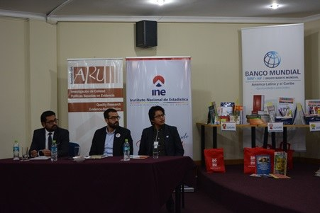
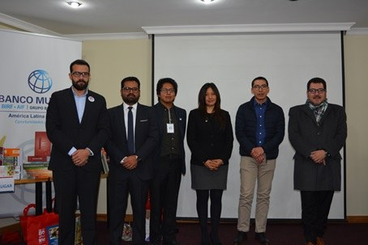
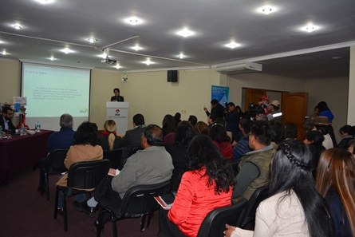

El jueves 5 de julio de 2018, en el auditorio Jorge Félix Ballivián del Instituto Nacional de
Estadística (INE), el INE y la Fundación Aru realizaron el lanzamiento oficial de la **Primera
Competencia Boliviana de Pósters Estadísticos 2018–2019**, parte del Proyecto Internacional de
Alfabetización Estadística (ISLP).

Participaron representantes de las instituciones patrocinadoras: el Banco Mundial, la FAO,
UNICEF, la Carrera de Estadística de la UMSA y la Universidad Privada de Santa Cruz de la Sierra
(UPSA), además de medios de comunicación.

El director del INE, Santiago Farjat, destacó que el objetivo del concurso es fortalecer la
capacidad de interpretar y evaluar críticamente la información estadística, y mejorar el
razonamiento y la comunicación de los datos en colegios y universidades. Como premio para los
ganadores, el INE dispuso **1.065 publicaciones** estadísticas.

La convocatoria se abrió en tres categorías: **Bernoulli** y **Poisson**, para estudiantes de
secundaria, y **Gauss**, para universitarios de pregrado.

[Boletín de lanzamiento](../../../img/boletines/boletin-1-lanzamiento-2018.pdf){.btn .btn-outline-terracota role="button"}
