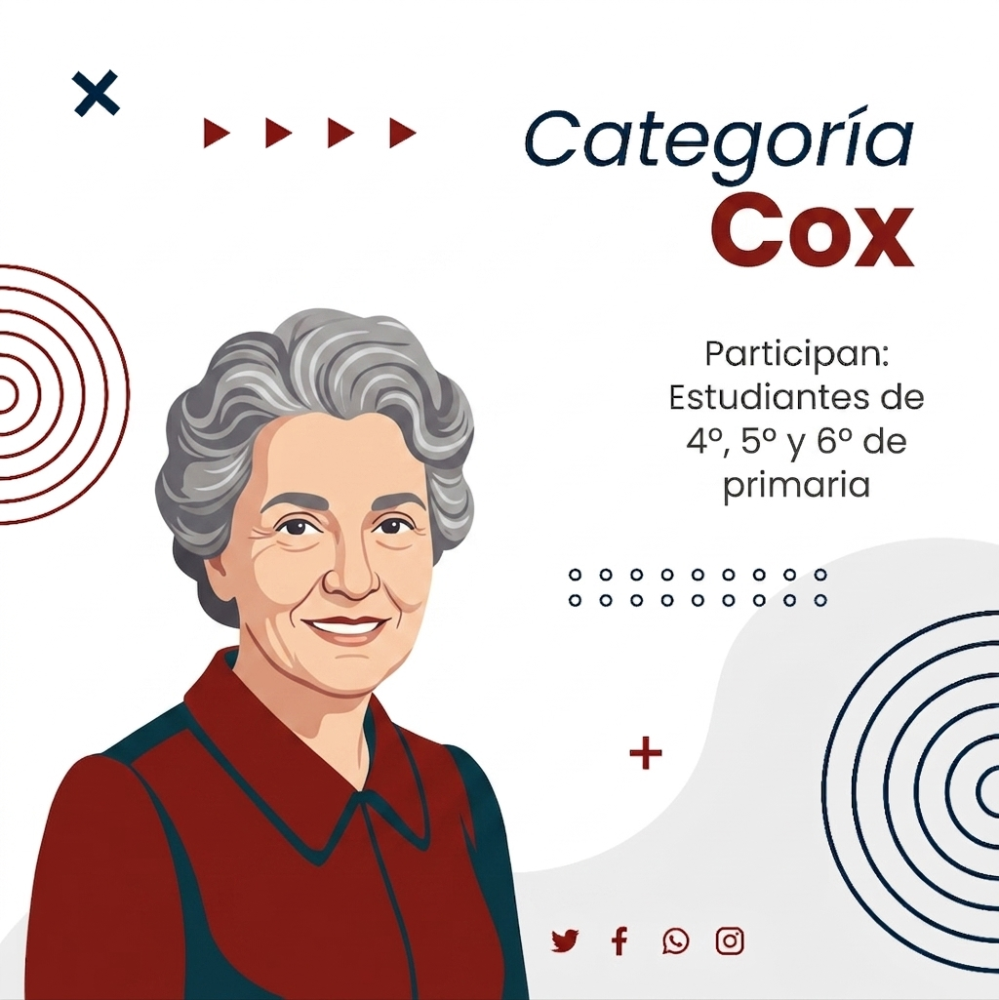
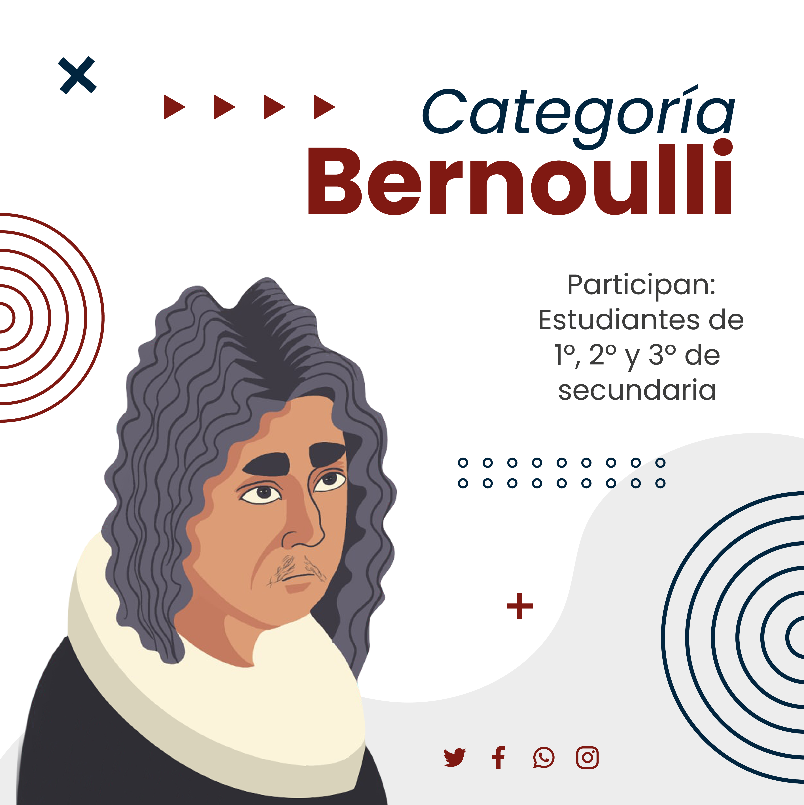
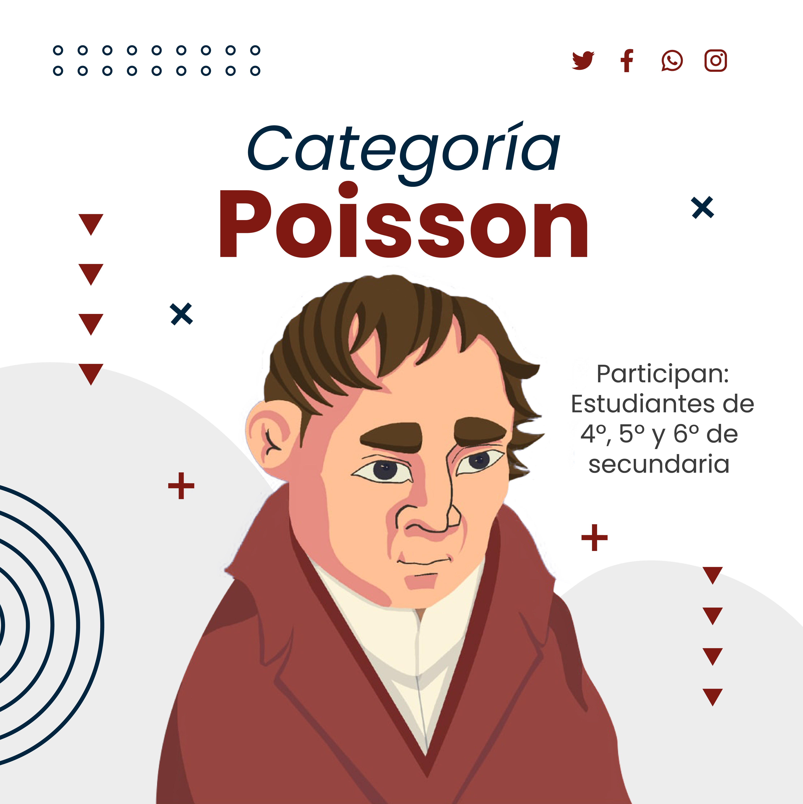
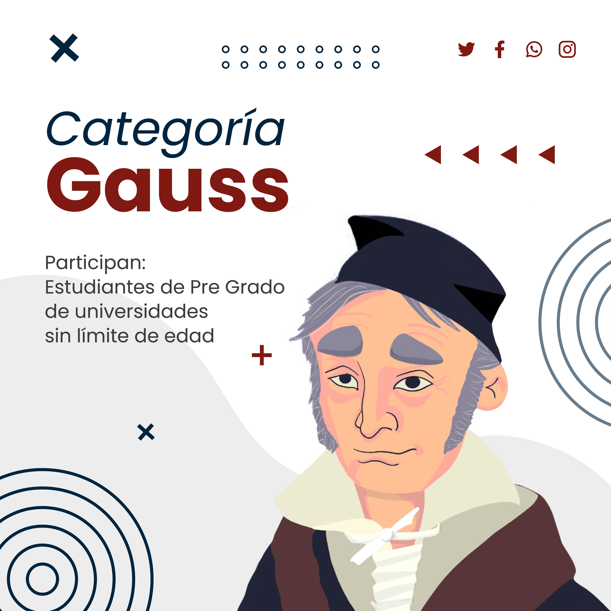

Inscripciones abiertas hasta marzo de 2027

Postula tu investigación y forma parte del principal evento de alfabetización estadística de Bolivia. Equipos de 2 a 5 estudiantes, guiados por un tutor, presentan un póster estadístico original. Los mejores trabajos representan a Bolivia en la [competencia internacional del ISLP](https://iase-web.org/islp), presente en más de 120 países.

[Inscríbete ahora](inscripcion.qmd){.btn .btn-terracota .btn-lg role="button"}

## Categorías

Pueden participar todos los estudiantes de Bolivia formando equipos de 2 a 5 personas más un tutor, en una de las siguientes categorías:

::: {.categorias-grid}

::: {.categoria-card}
{.categoria-img}

### Categoría Cox

9 a 12 años · Primaria Alta

Primeros pasos en el pensamiento estadístico, explorando una pregunta simple de la realidad cotidiana: encuestas escolares, comparaciones del entorno, registros de fenómenos cotidianos.
:::

::: {.categoria-card}
{.categoria-img}

### Categoría Bernoulli

13 a 15 años · Secundaria baja

Recolección y descripción de datos: encuestas a grupos escolares o comunitarios, datos socioeconómicos locales, comparaciones entre grupos o periodos, uso de datos abiertos del INE.
:::

::: {.categoria-card}
{.categoria-img}

### Categoría Poisson

16 a 18 años · Secundaria Alta

Trabajos que van más allá de la descripción: problemáticas sociales con datos secundarios, salud, educación o medio ambiente, diseño de encuesta propio y análisis inferencial básico.
:::

::: {.categoria-card}
{.categoria-img}

### Categoría Gauss

Universitarios · Sin límite de edad

Investigaciones originales con datos primarios o secundarios, aplicación de modelos estadísticos, análisis de encuestas nacionales (EH, ECOVID, Censos), rigor metodológico y profundidad de análisis.
:::

:::

## Premios y reconocimientos

- **1.er lugar por categoría** — trofeo y diploma para todos los integrantes del equipo y su tutor. Representa a Bolivia en la competencia internacional.
- **2.do y 3.er lugar por categoría** — diploma de reconocimiento por su destacada participación.
- **Todos los participantes** — certificado digital de participación para los equipos que envíen su póster completo.

## Fechas importantes

::: {.timeline}

::: {.timeline-item}

Octubre 2026

#### Lanzamiento de la competencia
Presentación oficial de la quinta versión; difusión de la plataforma de información; publicación de la convocatoria.
:::

::: {.timeline-item}

Octubre 2026 — Marzo 2027

#### Periodo de registro y envío del póster
Apertura de inscripción de grupos; envío de pósters al correo de recepción; publicación de recursos y tutoriales; talleres de orientación a demanda.
:::

::: {.timeline-item}

Febrero 2027

#### Cierre de registro
Último mes habilitado para la inscripción del grupo y envío de pósters; tabulación final del registro de participantes.
:::

::: {.timeline-item}

Marzo 2027

#### Evaluación del póster
Reunión de la comisión de evaluación; distinción de los tres primeros lugares para cada categoría.
:::

::: {.timeline-item}

Mayo 2027

#### Premiación nacional
Convocatoria a los grupos ganadores; ceremonia de premiación de los pósters ganadores por categoría.
:::

:::

## Bases del concurso

Las bases contienen toda la información necesaria para la correcta postulación: criterios de admisibilidad, formato del póster, plazos y lineamientos de evaluación. Revisarlas asegura que tu trabajo cumpla con los estándares del Comité Evaluador.

[Normas de participación](img/docs27/rules27.pdf){.btn .btn-outline-terracota role="button"}
[Guía de elaboración del póster](img/docs27/guia27.pdf){.btn .btn-outline-terracota role="button"}
[Guía de elaboración del póster (Primaria)](img/docs27/rules2p.pdf){.btn .btn-outline-terracota role="button"}
[Criterios de evaluación](img/docs27/criterios27.pdf){.btn .btn-outline-terracota role="button"}

### ¿Quiénes pueden participar?

- Todos los adolescentes y jóvenes de Bolivia, bajo el asesoramiento de un profesor, docente, especialista o investigador.
- Equipos de 2 a 5 estudiantes más un guía o tutor.
- La inscripción es libre y gratuita, y debe realizarla preferentemente el tutor del equipo.

### ¿Qué características debe tener el póster?

- Tema de investigación libre, basado en el uso, análisis e interpretación de estadísticas.
- Los datos pueden ser recopilados por los participantes o provenir de una fuente confiable ya publicada (citando la fuente).
- Formato bidimensional, una sola hoja, tamaño máximo A1 (841 × 594 mm), archivo de hasta 10 MB.
- Debe incluir: lo que se estudió, resultados principales, discusión y conclusiones, con gráficos titulados y comentados.
- No se aceptan pósters ya enviados a competencias anteriores.

### Condiciones de Uso de IA

* **Categoría Primaria:** El uso de herramientas de Inteligencia Artificial no está permitido.
* **Categorías Secundaria y Universitaria:**
  * **Transparencia obligatoria:** Se debe revelar el uso de la IA, su propósito y los *prompts* utilizados.
  * **Uso exclusivo de soporte:** La IA no puede sustituir el pensamiento crítico, las ideas, el trabajo experimental ni las conclusiones del estudiante.
  * **Autoría original:** El proyecto debe ser trabajo del estudiante junto a su tutor. Está prohibido presentar contenido de IA como propio.
  * **Uso ético y citas:** Las sugerencias de la IA deben reescribirse con palabras propias para evitar alertas de plagio. Toda fuente o dato factual provisto por la IA debe ser verificado y citado.
* **Sanciones:** El jurado descalificará cualquier proyecto con sospecha razonable de plagio o uso inapropiado de IA.

### Fuentes de datos sugeridas

| Institución | Enlace |
|---|---|
| FAO | [Explora →](http://www.fao.org/faostat/es/#home) |
| Banco Mundial | [Explora →](https://databank.worldbank.org/home.aspx) |
| Instituto Nacional de Estadística (INE) | [Explora →](https://www.ine.gob.bo/) |
| UNICEF | [Explora →](https://data.unicef.org/) |

## Cómo inscribirte

1. **Lee las normas** de participación y los requisitos de tu categoría.
2. **Descarga la guía** completa para la elaboración de tu póster estadístico.
3. **Prepara tu póster** siguiendo los criterios especificados.
4. **Completa el formulario de inscripción** con los datos de tu equipo.

[Formulario de inscripción](inscripcion.qmd){.btn .btn-terracota .btn-lg role="button"}

## Preguntas frecuentes

¿Qué es un póster estadístico?

Una presentación visual que cuenta una historia con datos: incluye una pregunta de investigación, la recolección y análisis de datos, y las conclusiones derivadas. El formato es libre, pero debe ser claro y comunicar correctamente los resultados.

¿En qué formato debe enviarse el póster?

En PDF o imagen de alta resolución (JPG/PNG), al correo islp.bolivia@gmail.com. Dimensiones recomendadas A1 (841 × 594 mm) o proporciones similares, archivo de hasta 10 MB.

¿Cómo se evalúan los pósters?

Con cuatro criterios: pertinencia estadística, calidad de los datos, presentación visual y solidez de las conclusiones.

¿Necesito conocimientos avanzados de estadística?

No. Se valora la curiosidad, el uso apropiado de datos y la claridad al comunicar hallazgos. Para primaria y secundaria son válidos gráficos de barras, tablas de frecuencia o proporciones simples, bien interpretados.

¿Cuál es la fecha límite de envío?

El período de inscripción y envío va de octubre de 2026 a febrero de 2027, con cierre definitivo en febrero de 2027.

¿No encontraste respuesta a tu pregunta? [Escríbenos a Facebook](https://www.facebook.com/islpBolivia/) o revisa la [página de contacto](contacto.qmd).
