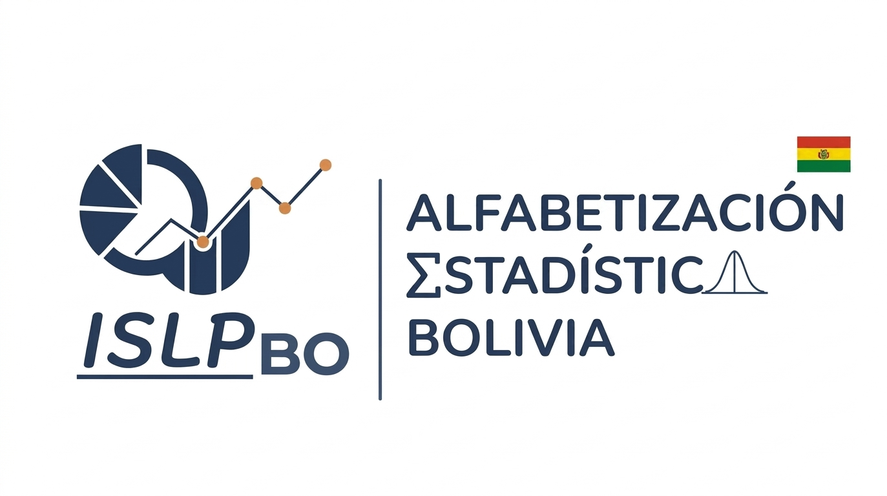
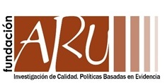
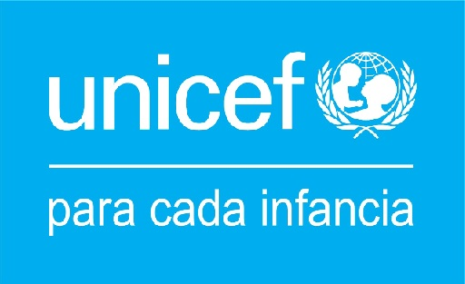
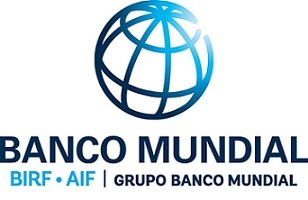
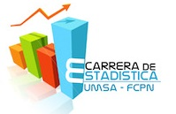
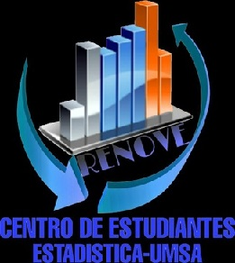
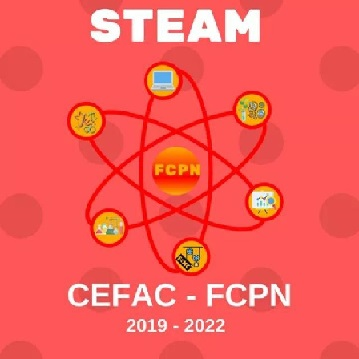
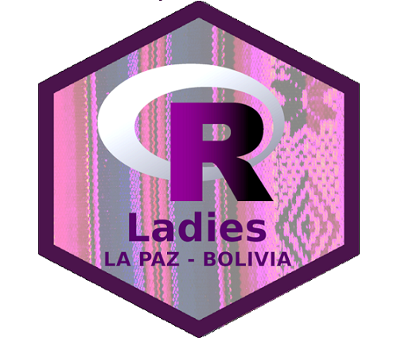

::: {.hero}
::: {.hero-grid}

::: {.hero-text}

Alfabetización Estadística Bolivia

# Formando una cultura de datos en Bolivia

Somos la iniciativa boliviana del Proyecto Internacional de Alfabetización Estadística (ISLP). Impulsamos la Competencia Boliviana de Pósters Estadísticos, Paneles de Alfabetización, Grupos de Estudio y una red de contacto entre estadísticos, para acercar el pensamiento estadístico a estudiantes y profesionales de todo el país.

[Inscríbete a la competencia](inscripcion.qmd){.btn .btn-terracota .btn-lg role="button"}
[Conoce nuestras actividades](#actividades){.btn .btn-outline-terracota .btn-lg role="button"}

:::

::: {.hero-image}

:::

:::
:::

## Nuestras actividades {#actividades}

Tres frentes de trabajo con un mismo objetivo: que más personas en Bolivia piensen, lean y comuniquen con datos.

::: {.pillars}

::: {.pillar-card}

01 · COMPETENCIA

### Competencia de Pósters Estadísticos

Equipos de estudiantes de primaria a universidad investigan una pregunta real y la comunican en un póster. Se realiza cada dos años y culmina representando a Bolivia en la competencia internacional del ISLP.

[Ver edición actual →](competencia.qmd)
:::

::: {.pillar-card}

02 · PANELES

### Paneles de Alfabetización

Charlas y paneles abiertos donde profesionales y estudiantes conversan sobre el uso de datos y estadística en problemas reales de Bolivia.

[Ver más →](paneles.qmd)
:::

::: {.pillar-card}

03 · GRUPOS DE ESTUDIO

### Grupos de Estudio

Espacios periódicos de aprendizaje colaborativo en estadística y análisis de datos, abiertos a quienes quieren profundizar más allá del aula.

[Ver más →](grupos-estudio.qmd)
:::

::: {.pillar-card}

04 · RED

### Red de Estadísticos

Ofertas laborales, congresos y capacitaciones circulando entre quienes trabajan o estudian estadística en Bolivia, en un canal ágil de comunicación.

[Ver más →](comunidad.qmd)
:::

:::

## Últimas noticias

Novedades cortas de la iniciativa: convocatorias, resultados y avisos.

::: {.updates-carousel}
::: {#home-updates}
:::
:::

[Ver todas las noticias →](actualizaciones/index.qmd)

## Competencia Boliviana de Pósters Estadísticos — Quinta edición

Inscripciones abiertas · 2026–2027

Postula tu investigación y forma parte del principal evento de alfabetización estadística de Bolivia. Equipos de 2 a 5 personas, guiados por un tutor, en cuatro categorías según edad.

[Ver bases e inscripción](competencia.qmd){.btn .btn-terracota role="button"}
[Ver ediciones pasadas](pasadas.qmd){.btn .btn-outline-terracota role="button"}

## Instituciones que han apoyado

<!--
El respaldo institucional varía según la edición de la competencia (no son socios
permanentes). Actualiza este listado por edición si quieres reflejar exactamente quién
apoyó cada versión. Reemplaza cada img/logos/<archivo>.png por el logo real (con los
derechos correspondientes) y ajusta el enlace a la web de cada institución en Bolivia.
-->

El respaldo institucional ha variado según la edición de la competencia. Estas son algunas de las instituciones que colaboraron en distintos momentos:

::: {.logo-marquee}

<!-- Bloque duplicado para que el desplazamiento sea continuo — no lo borres -->

:::

[Conoce al equipo y colaboradores →](nosotros.qmd)
