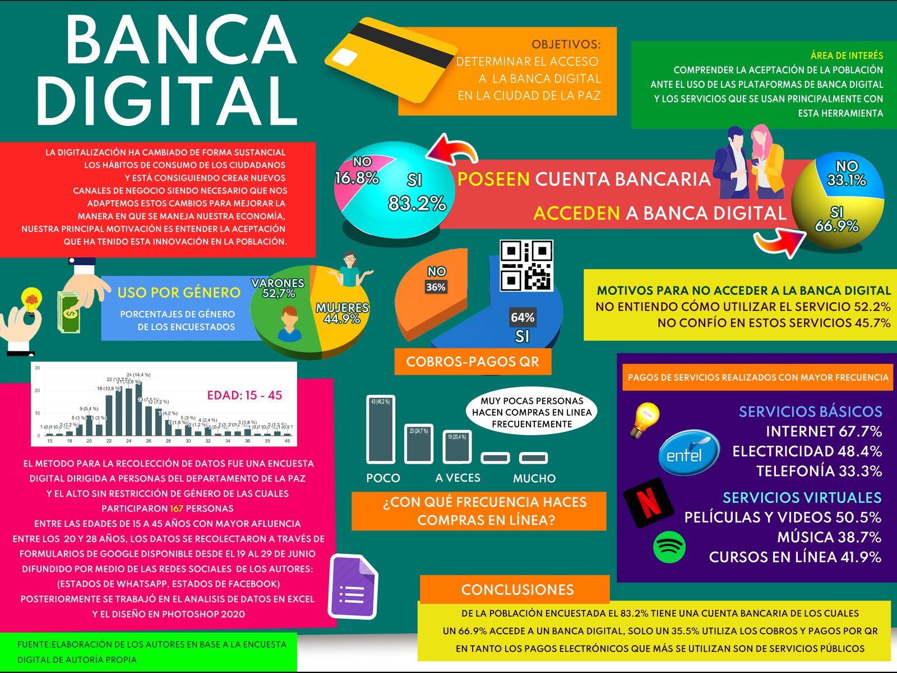
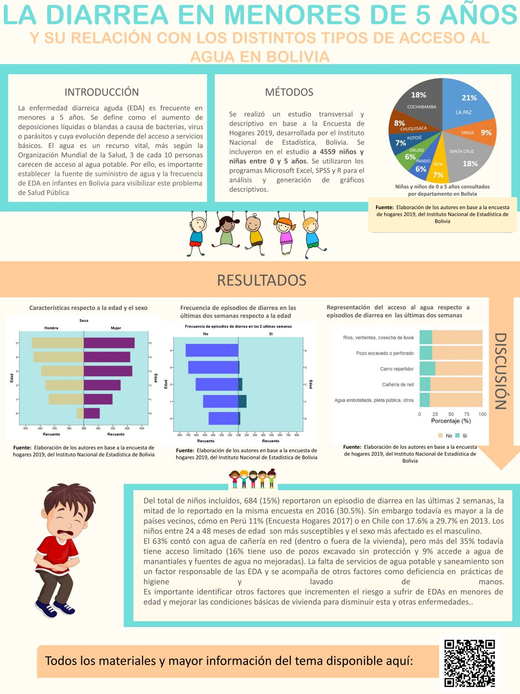
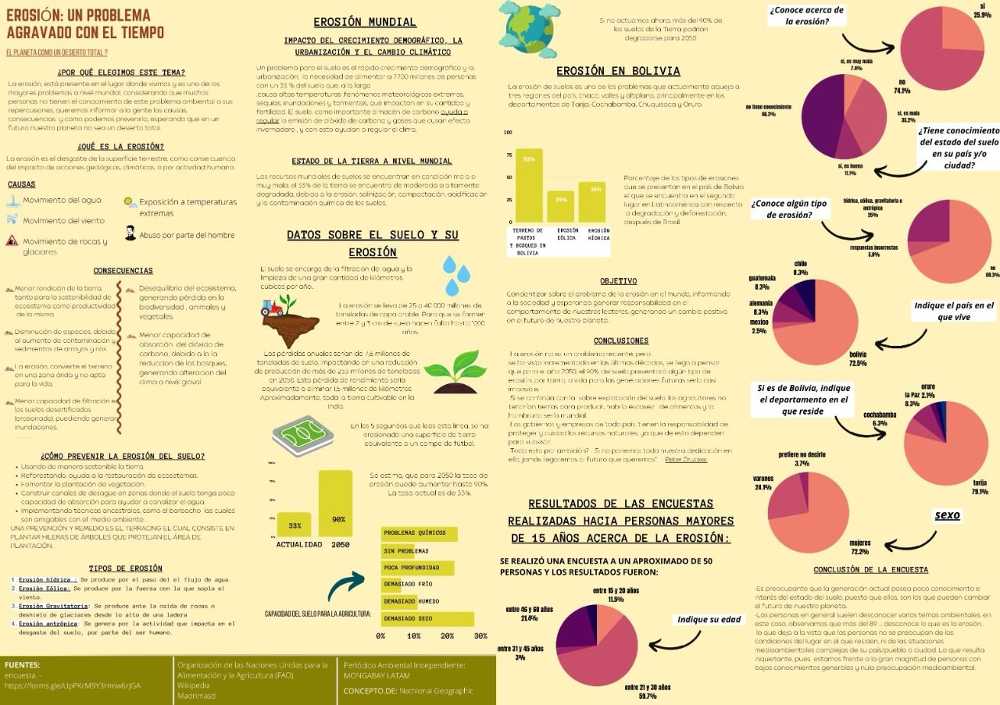
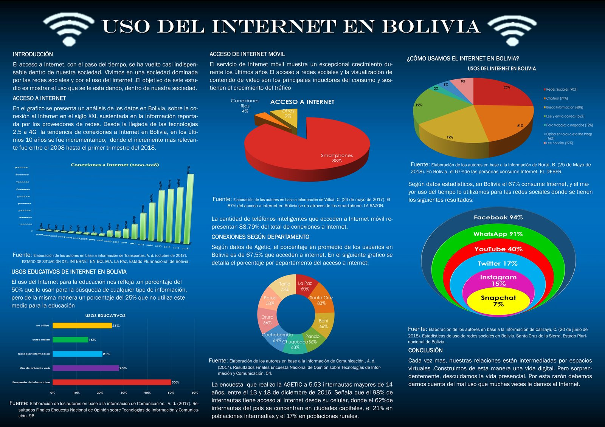
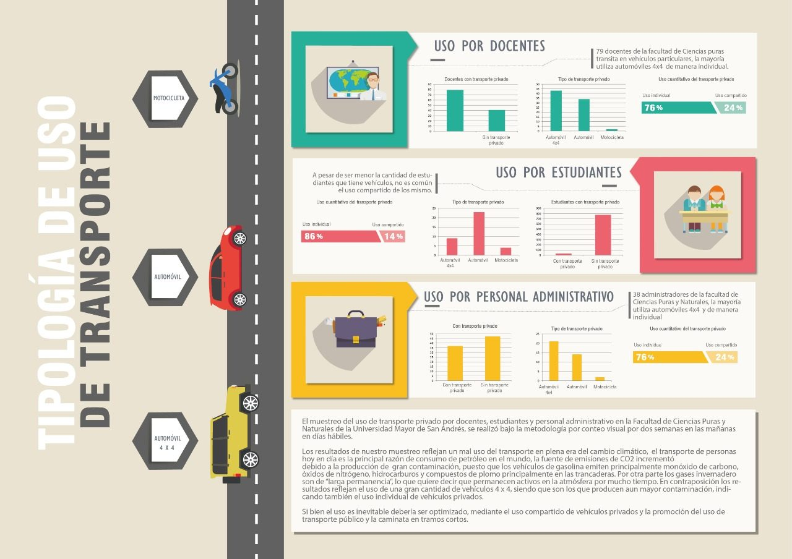
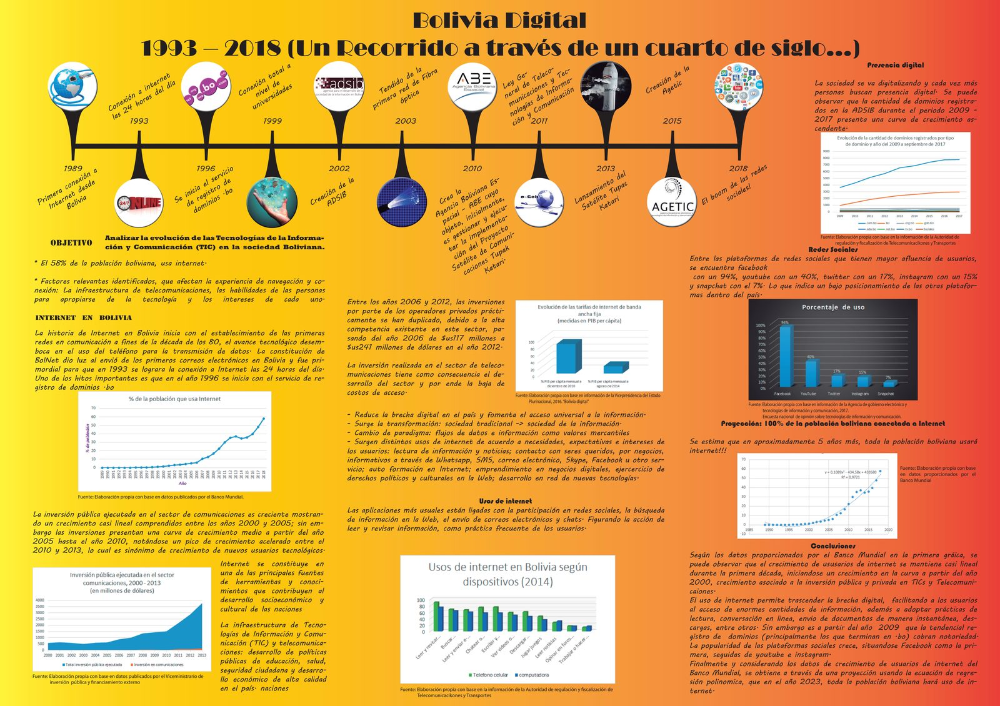
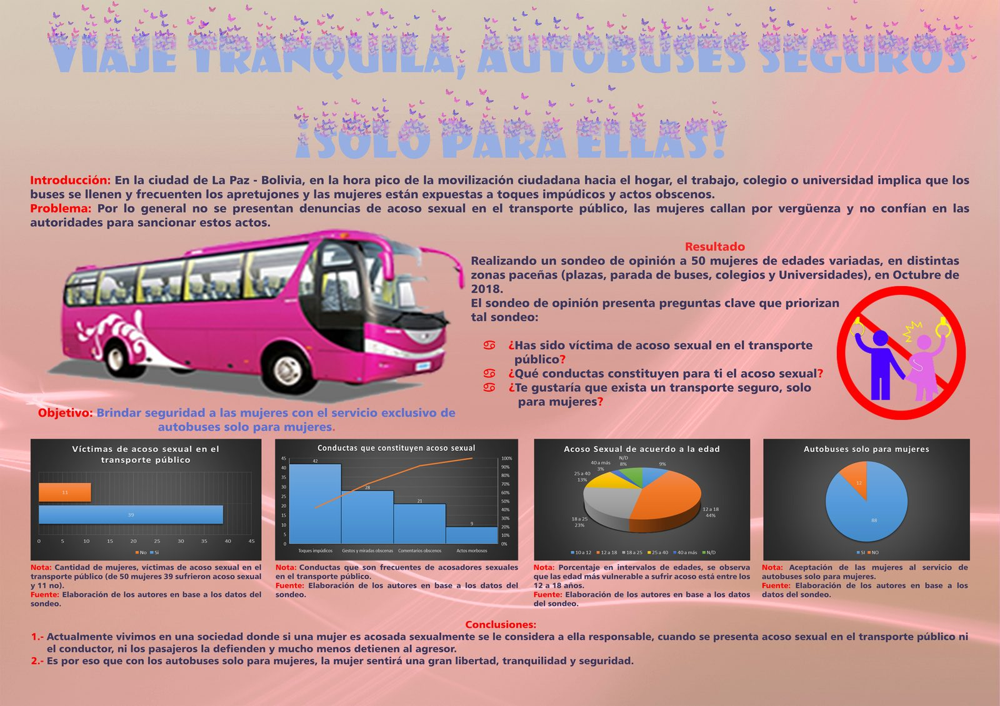
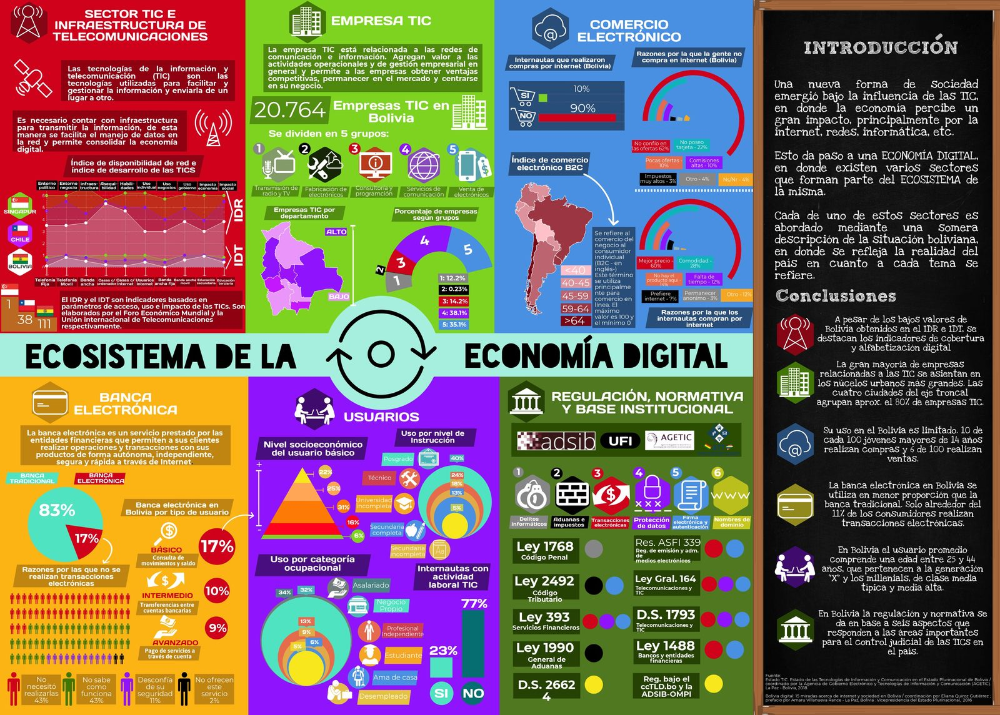
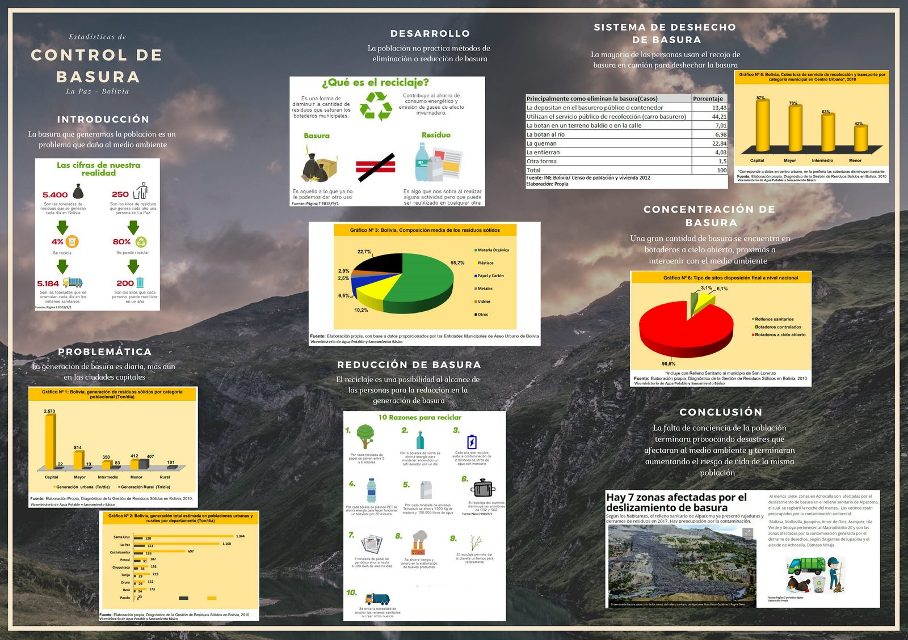
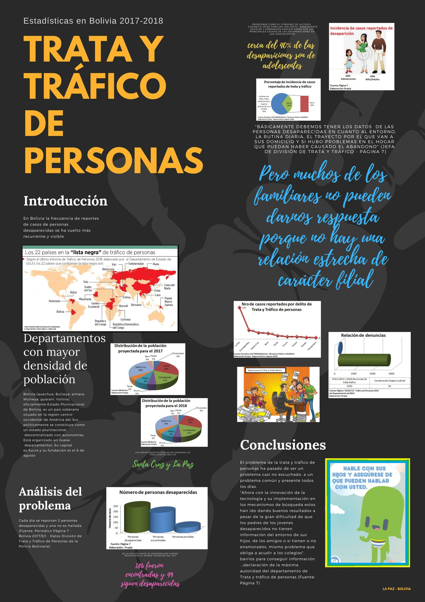

La competencia se realiza cada dos años. Aquí encuentras el archivo de todas las ediciones anteriores, con sus afiches, criterios, guías y los pósters ganadores por categoría.

<!--
Para cada edición: reemplaza las imágenes de img/ganadores/<edicion>/ con el póster ganador
de cada categoría (jpg/png), o enlaza directamente un PDF cambiando la extensión — el
navegador lo abre igual al hacer clic. Puedes agregar o quitar bloques {.gallery-item} según
cuántos ganadores quieras mostrar por edición. Haz clic en "Ver galería" para desplegarla.
-->

::: {.edicion-card}

#### 4ª · 2024 — 2025

Equipos ganadores:

- **Gauss**: 1.er lugar, equipo "Doble A" (Alba Alejandra Ortiz Alcocer y Adrián Marcelo Requena Oros); 2.° lugar, "Team medio ambiente forever" (Mishel Diana Flores Urrutia y Herlan David Poroma Alanoca); 3.er lugar, "Los Desvelados" (Carol Katerine Canqui Uturunco y Huáscar Diego Cuentas Ramos). Todos de La Paz.
- **Poisson**: 1.er lugar, equipo "Georginas" (Santa Cruz).

Pronto publicaremos el afiche y los pósters ganadores de esta edición.

:::

::: {.edicion-card}

#### 3ª · 2022 — 2023

Premiación el 12 de abril de 2023 en el auditorio del INE, con 9 equipos ganadores en las categorías Bernoulli, Poisson y Gauss. El equipo ganador de Gauss, "Los Embriones" (UMSA), obtuvo el **3.er lugar en la competencia internacional del ISLP 2023** con el póster *Explorando la mortalidad infantil en Bolivia y el mundo*.

Equipos ganadores:

- **Gauss**: 1.er lugar, "Los Embriones" (Daniel Linares Terrazas y Edson Loayza Siñani, UMSA); 2.° lugar, "El Grupito" (Maya Alexandra Jurado Veizan y Adriel Rocel Alarcón Gerl, UMSA); 3.er lugar, *Índice de violencia contra la mujer en Bolivia* (Luz Gabriela Tinta Chura y Herlan Gabriel Callisaya Ramos, UMSA).
- **Poisson**: 1.er lugar, "Aeternus" (Colegio San Calixto); 2.° lugar, "AJAYU" (U.E. La Paz "A"); 3.er lugar, "Jóvenes dinámicos" (U.E. José Martí).
- **Bernoulli**: 1.er lugar, "Los pensadores" (Instituto Americano y U.E. de Mallasa); 2.° lugar, "Golden Warriors" (El Alto); 3.er lugar, "Futuro" (U.E. de Mallasa e Instituto Americano).

[Ver afiche](img/afiche2022.pdf){.btn .btn-outline-terracota .btn-sm role="button"}
[Criterios](img/Criterios_a_Jusgar2022.pdf){.btn .btn-outline-terracota .btn-sm role="button"}
[Guía](img/guia_2022_2023.pdf){.btn .btn-outline-terracota .btn-sm role="button"}

:::

::: {.edicion-card}

#### 2ª · 2020 — 2021

Lanzada en noviembre de 2020, en plena pandemia, con talleres gratuitos de análisis de datos y el apoyo del Banco Mundial, la FAO, el INE, la Fundación Aru, R-Ladies La Paz y el Centro de Estudiantes de Estadística de la UMSA. Los pósters se recibieron de noviembre de 2020 a enero de 2021, y la premiación fue virtual, el 16 de abril de 2021. Hubo equipos ganadores de La Paz, Cochabamba y Tarija.

[Ver afiche](img/afiche2020.jpg){.btn .btn-outline-terracota .btn-sm role="button"}
[Reglas](img/reglas2020_2021.pdf){.btn .btn-outline-terracota .btn-sm role="button"}
[Criterios](img/criterios_2020_2021.pdf){.btn .btn-outline-terracota .btn-sm role="button"}
[Guía](img/guia_2020_2021.pdf){.btn .btn-outline-terracota .btn-sm role="button"}
[Boletín](img/boletines/boletin-3-segunda-edicion.pdf){.btn .btn-outline-terracota .btn-sm role="button"}

::: {.gallery-toggle}

Ver galería de pósters ganadores

::: {.gallery-grid}

::: {.gallery-item}

**1.er lugar · Gauss** *Factores que influyen en la educación en Bolivia* Zulema Quispe, Noemí Condori, Víctor Marca y Ana Carolina Mendoza
:::

::: {.gallery-item}

**2.° lugar · Gauss** *Banca digital* Laskar Israel Quisbert Torrez
:::

::: {.gallery-item}

**3.er lugar · Gauss** *La diarrea en menores de 5 años y su relación con el acceso al agua* Equipo "Hijos de Hipócrates" (UMSS y UMSA)
:::

::: {.gallery-item}

**1.er lugar · Poisson** *Tráfico de vida silvestre en Bolivia* Equipo "Women in Action" (El Alto)
:::

::: {.gallery-item}

**2.° lugar · Poisson** *Erosión: un problema agravado con el tiempo* Equipo "Voiles" (U.E. Santa Ana 3, Tarija)
:::

::: {.gallery-item}

**1.er lugar · Bernoulli** *Contaminación atmosférica* Equipo "Los protectores del aire" (La Paz)
:::

:::

:::

:::

::: {.edicion-card}

#### 1ª · 2018 — 2019

Edición inaugural, lanzada el 5 de julio de 2018 en el auditorio del INE por el Instituto Nacional de Estadística y la Fundación Aru. Se recibieron **26 pósters de 97 estudiantes** de La Paz y Santa Cruz, en las categorías Bernoulli, Poisson y Gauss. La premiación fue el 15 de abril de 2019, y los primeros lugares representaron a Bolivia en la competencia internacional, cuyos resultados se anunciaron en el 62.° Congreso Mundial de Estadística, en Kuala Lumpur (Malasia), en agosto de 2019.

[Ver afiche](img/afiche2018.jpg){.btn .btn-outline-terracota .btn-sm role="button"}
[Guía](img/guia.pdf){.btn .btn-outline-terracota .btn-sm role="button"}
[Boletín de lanzamiento](img/boletines/boletin-1-lanzamiento-2018.pdf){.btn .btn-outline-terracota .btn-sm role="button"}
[Boletín de premiación](img/boletines/boletin-clausura-1ra-edicion.pdf){.btn .btn-outline-terracota .btn-sm role="button"}

::: {.gallery-toggle}

Ver galería de pósters ganadores

::: {.gallery-grid}

::: {.gallery-item}

**1.er lugar · Gauss** *Uso del Internet en Bolivia* Araceli Morales, Edgar Callizaya, Noemí Marani y Juana Poma
:::

::: {.gallery-item}

**2.° lugar · Gauss** *Tipología de uso de transporte* Verónica Guibarra, Selena Ticona y Samantha Cortez
:::

::: {.gallery-item}

**3.er lugar · Gauss** *Bolivia Digital 1993–2018* Gabriel Condori y Joseline Villca
:::

::: {.gallery-item}

**Reconocimiento especial · Gauss** *Viaje tranquila, autobuses seguros ¡Solo para ellas!* Erika Huanca, Claudia Pardo, Henry Limachi y Wildo Larico
:::

::: {.gallery-item}

**1.er lugar · Poisson** *Ecosistema de la economía digital* Benjamín Reydet y Marcelo Fortún
:::

::: {.gallery-item}

**1.er lugar · Bernoulli** *Control de basura* Emily Mamani, Eliazarth Inca, Maday Laura y Mishel Mamani
:::

::: {.gallery-item}

**2.° lugar · Bernoulli** *Trata y tráfico de personas* Maribel Quispe, Maribel Quispe y María Liz Mena
:::

:::

:::

:::

## Pósters bolivianos en la competencia internacional

Para ver los pósters de las competencias internacionales pasadas, visita las páginas oficiales del ISLP:

- [Competencia Internacional 2020–2021](http://iase-web.org/islp/Poster_Competition_2020-2021.php?p=Posters)
- [Competencia Internacional 2018–2019](http://iase-web.org/islp/Poster_Competition_2018-2019.php?p=Posters)

[← Volver a la edición actual](competencia.qmd)
