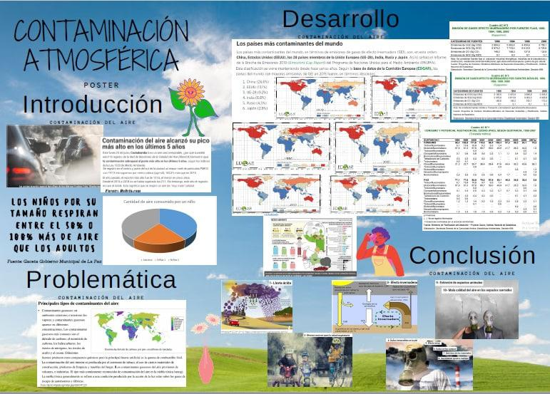
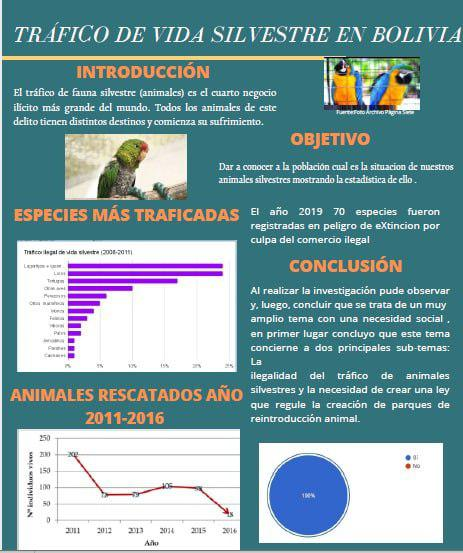
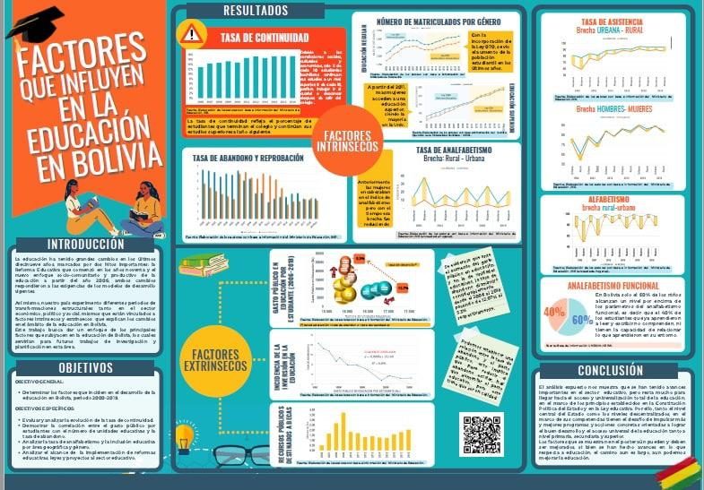

La competencia se realiza cada dos años. Aquí encuentras el archivo de todas las ediciones anteriores, con sus afiches, criterios, guías y los pósters ganadores por categoría.

<!--
Para cada edición: reemplaza las imágenes de img/ganadores/<edicion>/ con el póster ganador
de cada categoría (jpg/png), o enlaza directamente un PDF cambiando la extensión — el
navegador lo abre igual al hacer clic. Puedes agregar o quitar bloques {.gallery-item} según
cuántos ganadores quieras mostrar por edición. Haz clic en "Ver galería" para desplegarla.
-->

::: {.edicion-card}

#### 4ª · 2024 — 2025

Información de esta edición en preparación: pronto publicaremos afiche, ganadores y pósters.

:::

::: {.edicion-card}

#### 3ª · 2022 — 2023

Premiación el 12 de abril de 2023 en el auditorio del INE, con 9 equipos ganadores en las categorías Bernoulli, Poisson y Gauss. El equipo ganador de Gauss, "Los Embriones" (UMSA), obtuvo el **3.er lugar en la competencia internacional del ISLP 2023** con el póster *Explorando la mortalidad infantil en Bolivia y el mundo*.

[Ver afiche](img/afiche2022.pdf){.btn .btn-outline-terracota .btn-sm role="button"}
[Criterios](img/Criterios_a_Jusgar2022.pdf){.btn .btn-outline-terracota .btn-sm role="button"}
[Guía](img/guia_2022_2023.pdf){.btn .btn-outline-terracota .btn-sm role="button"}

:::

::: {.edicion-card}

#### 2ª · 2020 — 2021

Lanzada en noviembre de 2020, en plena pandemia, con talleres gratuitos de análisis de datos. La premiación fue virtual, el 16 de abril de 2021, junto al INE y la Fundación Aru.

[Criterios](img/criterios_2020_2021.pdf){.btn .btn-outline-terracota .btn-sm role="button"}
[Guía](img/guia_2020_2021.pdf){.btn .btn-outline-terracota .btn-sm role="button"}

::: {.gallery-toggle}

Ver galería de pósters ganadores

::: {.gallery-grid}

::: {.gallery-item}

1.er lugar · Bernoulli
:::

::: {.gallery-item}

1.er lugar · Poisson
:::

::: {.gallery-item}

1.er lugar · Gauss
:::

:::

:::

:::

::: {.edicion-card}

#### 1ª · 2018 — 2019

Edición inaugural, lanzada en julio de 2018 por el INE y la Fundación Aru, con 26 equipos participantes. La premiación fue el 15 de abril de 2019 y los ganadores representaron a Bolivia en la competencia internacional, cuyos resultados se anunciaron en Kuala Lumpur (Malasia) en agosto de 2019.

[Ver afiche](img/cartel2.pdf){.btn .btn-outline-terracota .btn-sm role="button"}
[Guía](img/guia.pdf){.btn .btn-outline-terracota .btn-sm role="button"}

:::

## Pósters bolivianos en la competencia internacional

Para ver los pósters de las competencias internacionales pasadas, visita las páginas oficiales del ISLP:

- [Competencia Internacional 2020–2021](http://iase-web.org/islp/Poster_Competition_2020-2021.php?p=Posters)
- [Competencia Internacional 2018–2019](http://iase-web.org/islp/Poster_Competition_2018-2019.php?p=Posters)

[← Volver a la edición actual](competencia.qmd)
